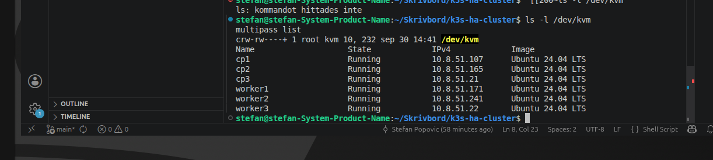
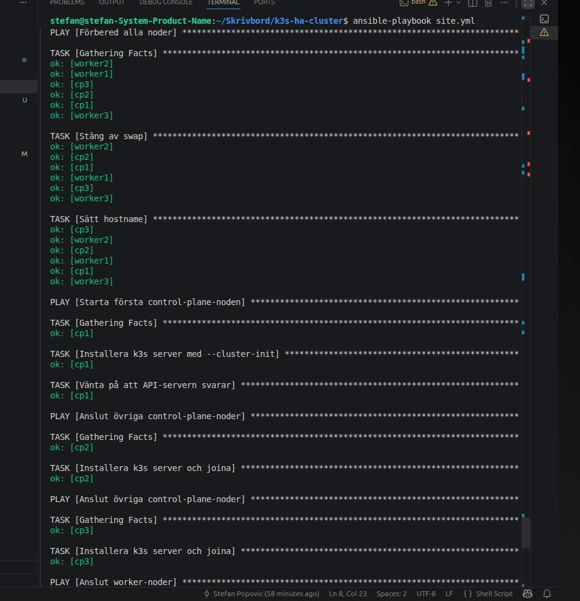
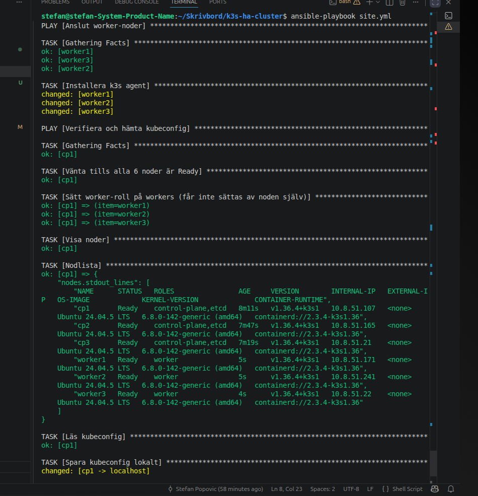
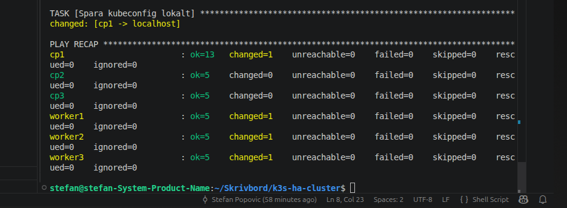
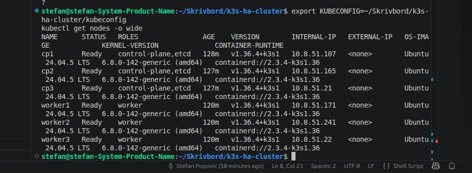
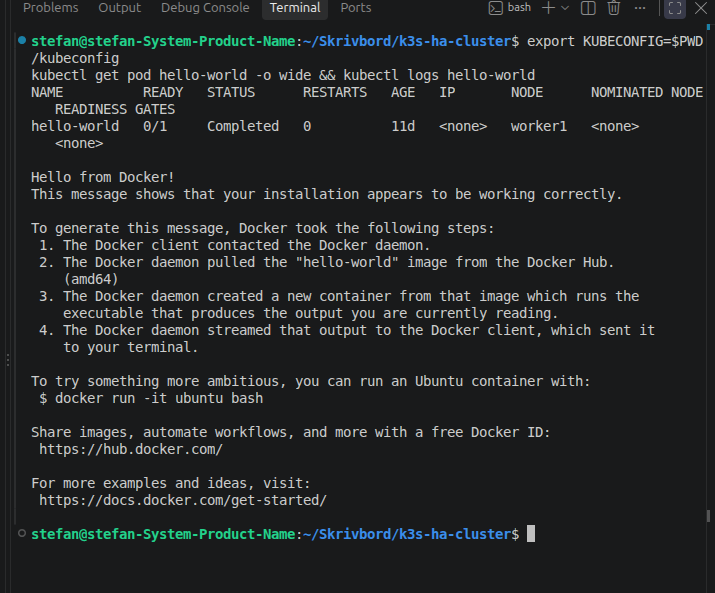
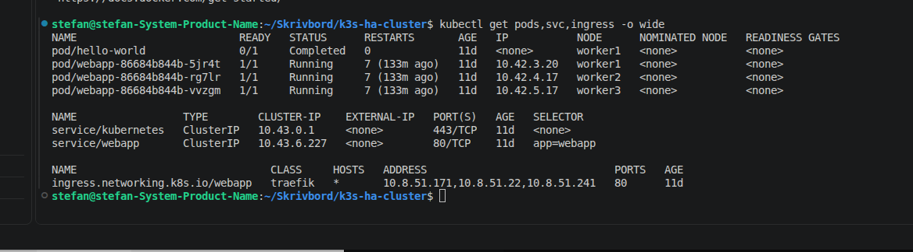
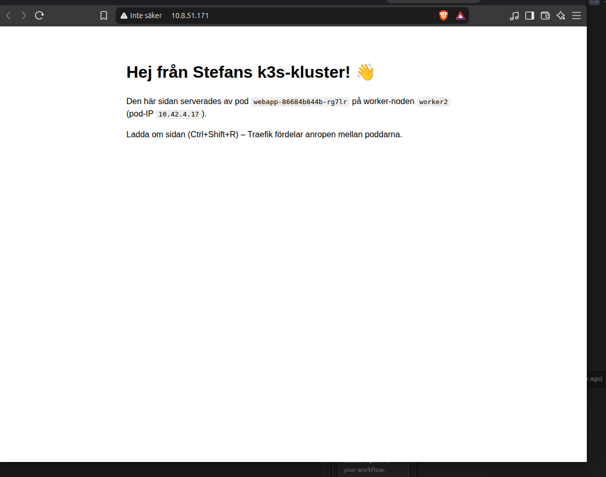

# k3s HA-kluster: 3 control-plane + 3 workers

Ett k3s-kluster med hög tillgänglighet som körs på 6 Multipass-VM:ar. Installationen görs med ett bash-skript och en Ansible-playbook. På klustret körs en hello-world-POD och en webbsida som går att nå från laptopens webbläsare.

## 1. Plan / arkitektur

| Nod     | Roll                 | IP (exempel)  | Taint                                         |
|---------|----------------------|---------------|-----------------------------------------------|
| cp1     | control-plane, etcd  | 10.8.51.107   | `node-role.kubernetes.io/control-plane:NoSchedule` |
| cp2     | control-plane, etcd  | 10.8.51.165   | `node-role.kubernetes.io/control-plane:NoSchedule` |
| cp3     | control-plane, etcd  | 10.8.51.21    | `node-role.kubernetes.io/control-plane:NoSchedule` |
| worker1 | worker               | 10.8.51.171   | –                                             |
| worker2 | worker               | 10.8.51.241   | –                                             |
| worker3 | worker               | 10.8.51.22    | –                                             |

- **3 control-plane-noder** med inbyggd etcd (`--cluster-init`). Med 3 etcd-medlemmar finns kvorum även om en nod går ner.
- **Ingen nod har dubbla roller.** Control-plane-noderna har taint `NoSchedule`, så våra appar schemaläggs bara på workers. Workers kör `k3s agent` och har varken API-server eller etcd.
- Varje VM har 2 CPU, 4 GB RAM och 10 GB disk och kör Ubuntu 24.04.

## 2. Filer

| Fil | Syfte |
|-----|-------|
| `00-create-vms.sh` | Skapar de 6 VM:arna med cloud-init och SSH-nyckel och genererar `inventory.ini`. Den går att köra om, eftersom VM:ar som redan finns hoppas över. |
| `site.yml` | Ansible-playbook som installerar k3s (första cp, övriga cp, workers), sätter worker-rollen och hämtar `kubeconfig`. Den går att köra om (`creates:` / `changed_when`). |
| `ansible.cfg` | Pekar på `inventory.ini`. |
| `group_vars/all.example.yml` | Mall för variablerna (kanal, token, cp1:s IP). |
| `manifests/01-hello-world-pod.yaml` | Hello world-POD. |
| `manifests/02-webapp.yaml` | Webbsida: ConfigMap → Deployment (3 pods) → Service → Ingress. |

`group_vars/all.yml`, `inventory.ini`, `kubeconfig` och `cloud-init.yaml` innehåller hemligheter eller genereras automatiskt, så de ligger i `.gitignore`.

## 3. Så kör du

Krav: Multipass, Ansible och kubectl på laptopen.

```bash
# 1. Variabler
cp group_vars/all.example.yml group_vars/all.yml
# sätt k3s_token (openssl rand -hex 32) och first_cp_ip (cp1:s IP efter steg 2)

# 2. Skapa VM:ar + inventory
./00-create-vms.sh

# 3. Installera klustret
ansible-playbook site.yml

# 4. Använd klustret från laptopen
export KUBECONFIG=$PWD/kubeconfig
kubectl get nodes -o wide

# 5. Deploya hello world + webbsida
kubectl apply -f manifests/
```

## 4. Resultat

**Setup**







**Hello world-POD.** Podden körs på en worker, skriver "Hello from Docker!" och avslutas (`Completed`):



**Webbsidan.** Tre pods körs, en på varje worker:



**Webbläsaren på laptopen**



## 5. Så når webbsidan laptopens webbläsare

Öppna **http://10.8.51.171/** i webbläsaren. Det går lika bra med de andra workernas IP (`.241`, `.22`). Vägen ser ut så här:

```
Webbläsare (laptop)
   │  HTTP till worker-IP:80
   ▼
Multipass-nätet 10.8.51.0/24  (brygga på laptopen, VM-IP:erna nås direkt)
   ▼
worker-IP:80
   │  ServiceLB (svclb-traefik-pod på varje worker lyssnar på port 80)
   ▼
Traefik  (k3s inbyggda ingress-controller, kör i kube-system)
   │  matchar Ingress "webapp" (path /)
   ▼
Service "webapp" (ClusterIP 10.43.x.x:80)
   │  lastbalanserar över pods med app=webapp
   ▼
nginx-pod på worker1 / worker2 / worker3
```

1. **Laptop → VM.** Multipass skapar ett virtuellt nät (10.8.51.0/24) som laptopen själv är med i. VM:arnas IP:er går därför att nå direkt, utan port-forward.
2. **worker-IP:80 → ServiceLB.** k3s inbyggda lastbalanserare (ServiceLB/klipper-lb) ger Traefik-tjänsten typen `LoadBalancer`. Den startar en `svclb-traefik`-pod som binder port 80 på noden. Playbooken sätter etiketten `svccontroller.k3s.cattle.io/enablelb=true` på workers, så det är bara workernas IP:er som tar emot trafik.
3. **ServiceLB → Traefik.** Trafiken skickas vidare till Traefik-podden. Traefik är ett system-tillägg från k3s som tolererar control-plane-taint, så podden kan hamna på en cp-nod (t.ex. cp2). Våra egna appar körs ändå bara på workers.
4. **Traefik → Ingress → Service.** Traefik läser Ingress-resursen `webapp` och skickar `/` till Service `webapp`.
5. **Service → pod.** Servicen fördelar anropen över de 3 nginx-poddarna. Sidan visar vilken pod och nod som svarade. Ladda om med Ctrl+Shift+R så ser du att det växlar.

Kontroll från terminalen:

```bash
for ip in 10.8.51.171 10.8.51.241 10.8.51.22; do curl -s http://$ip/ | grep -o '<title>.*</title>'; done
```
